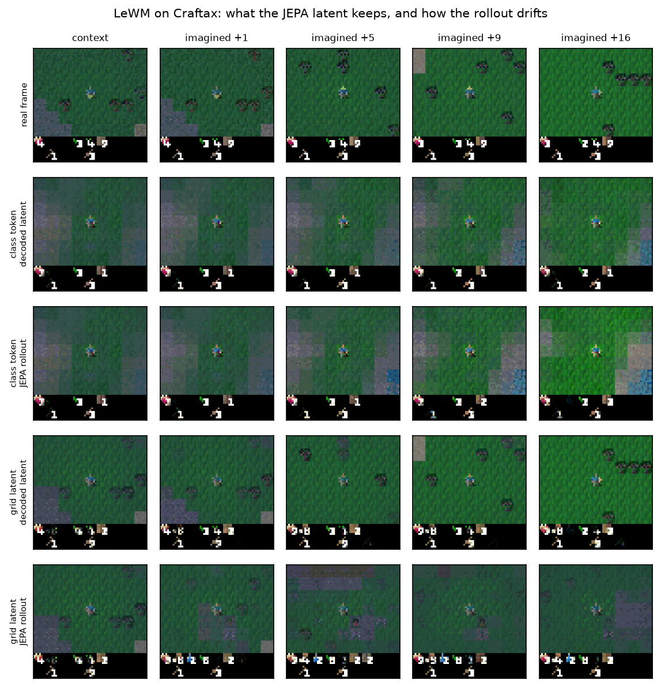
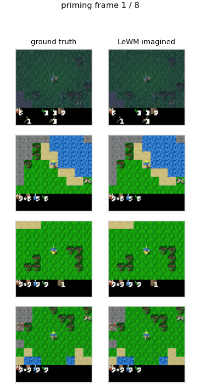

# tinycraft-jepa

**LeWorldModel (LeWM) on Craftax-Classic pixels, in JAX.** A joint-embedding predictive world
model trained under exactly the budget our generative pixel world model uses — **500k
transitions, 10 minutes on one A100** — and then taken apart off-budget: what does a JEPA
rollout actually contain, does it blur, mean-regress or go noisy, and can you plan in it?

Port of [lucas-maes/le-wm](https://github.com/lucas-maes/le-wm) (Maes\*, Le Lidec\*, Scieur,
LeCun, Balestriero, *LeWorldModel: Stable End-to-End Joint-Embedding Predictive Architecture
from Pixels*, arXiv:2603.19312) from PyTorch to JAX / Flax NNX. **The objective is unchanged**:

```
loss = mean((predict(z_t, a_t) - z_{t+1})^2) + 0.09 * SIGReg(z)
```

No stop-gradient on the target, no EMA teacher, no pretrained encoder, **no pixel decoder in the
loss**, no auxiliary supervision. Collapse is held off by SIGReg alone — the sketched
isotropic-Gaussian regularizer — which is checked numerically against a transcription of the
reference implementation in [tests/test_port.py](tests/test_port.py).



## Quickstart

```bash
uv venv --python 3.11 && uv pip install -r pyproject.toml --extra cuda && source .venv/bin/activate
python eval.py --download

python train.py --out runs/lewm/model.npz --lr 1e-3 --steps 12250     # the 10-minute budget
python viz.py  --model runs/lewm/model.npz --tag lewm --windows 2048  # latent diagnostics
python probe.py --model runs/lewm/model.npz                           # off-budget pixel decoder
python eval.py --model runs/lewm/model_decoder.npz --tag lewm --gif   # frozen benchmark
python plan.py --model runs/lewm/model.npz --tag lewm --closed-loop   # CEM planning in Craftax
```

`run_all.sh` chains all of it. Only `train.py` is inside the budget; everything after it is
analysis on a frozen model.

## Model

| part | what it is |
|---|---|
| encoder | ViT-tiny (192 wide, 12 layers), 7x7 patches over the 63x63 frame = 9x9 = 81 patches |
| read-out | class token (reference) or all 81 patch tokens (`--tokens 81`, "grid latent") |
| projector | Linear-BatchNorm-GELU-Linear, as in the reference |
| action encoder | one-hot(17) through the reference `Embedder` (bottleneck 10, SiLU MLP) |
| predictor | 6 causal AdaLN-zero blocks over the last 3 latents, conditioned on the action |
| regularizer | SIGReg: 17 knots, 1024 random projections, weight 0.09 |

17.9M parameters with the class-token read-out, 36.8M with the grid latent.

## Results

Single seed per configuration; 2048 held-out windows (8 context frames, 16 imagined steps).

### Inside the 10-minute budget

Wall-clock includes loading the 500k dataset and XLA compilation.

| run | latent | lr | wall | R² step 1 | R² step 16 | R² step 16, copy-last | spread ratio step 16 | action id top-1 | effective rank |
|---|---|---|---|---|---|---|---|---|---|
| `s0_lr5e-5` (paper lr) | 192 (cls) | 5e-5 | 574.9 s | 0.973 | 0.393 | 0.043 | 0.96 | 0.195 | 36 / 192 |
| `s0_lr3e-4` | 192 (cls) | 3e-4 | 576.0 s | 0.987 | 0.550 | 0.074 | 1.02 | 0.238 | 48 / 192 |
| `s0_lr1e-3` | 192 (cls) | 1e-3 | 574.2 s | 0.988 | **0.552** | 0.123 | 1.01 | 0.251 | 51 / 192 |
| `s0_grid` | 81x32 = 2592 | 1e-3 | 588.6 s | 0.987 | 0.141 | -0.276 | 0.94 | **0.559** | 64 / 2592 |

R² is measured in each model's own latent space against the variance of the true future latents,
so it compares a model to *itself*, not across rows; "copy-last" is the same number for a rollout
that repeats the last context latent. Action id top-1 is 17-way action recovery from one observed
transition (chance 0.059).

The learning rate matters more than anything else: the paper's 5e-5 is tuned for 100 epochs on a
small robotics dataset, and under ten minutes it is simply undertrained.

### Does it collapse?

No, and the diagnostics say precisely how far the regularizer gets.

* Class-token model: per-dimension std **1.03**, kurtosis **2.99**, mean |mean| **0.12** —
  standard-normal marginals, exactly as claimed.
* But the effective rank of that 192-d latent is **51**. Gaussian marginals do not make the
  covariance isotropic; a 1024-direction sketch over a 128-sample batch leaves plenty of
  anisotropy.
* The 2592-d grid latent is much further off: kurtosis **16.1**, per-dimension std between 0.35
  and 2.38, effective rank **64**. The same sketch size is far too small for that space. This is
  the part of the paper's stability story that thins out as the latent grows.

### Does the rollout blur, mean-regress or go noisy?

**None of the three, and the reason is the representation rather than the predictor.**

| | gFVD ↓ | AF ↑ | salient MSE ↓ | decoder MSE |
|---|---|---|---|---|
| copy the last frame | 0.01333 | 0.500 | 0.345 | – |
| `s0_lr1e-3` rollout | 0.03707 | 0.673 | 0.192 | 0.00695 |
| `s0_lr1e-3` decoder ceiling | 0.02590 | – | 0.139 | |
| `s0_grid` rollout | 0.03098 | 0.845 | 0.173 | 0.00043 |
| `s0_grid` decoder ceiling | **0.00160** | – | 0.016 | |
| tinywmcraft generative pixel WM | 0.00123 | 0.928 | – | – |

The *ceiling* rows decode the encoder's latents of the **real** future frames: that is the best
any rollout could look. For the class-token model the ceiling alone costs gFVD 0.0259, i.e.
**70% of its pixel error is the 192-d bottleneck, not the prediction** — the second row of the
figure above has already lost the trees before any imagination happens. Give the same objective a
spatial latent and the ceiling drops 16x to 0.0016 (on par with the generative world model's full
rollout), the benchmark's action-following jumps 0.67 → 0.85, and essentially all remaining pixel
error becomes prediction error.

Per-step diagnostics ([drift plot](artifacts/s0_lr1e-3_drift.png),
[grid version](artifacts/s0_grid_drift.png)):

* **No mean regression.** The batch spread of the predicted latents stays at 1.01 (class token)
  and 0.94 (grid) of the true spread through all 16 imagined steps; a mean-regressing model
  collapses towards 0. The latent heat maps ([gif](artifacts/s0_lr1e-3_latents.gif)) keep their
  contrast to the last step.
* **No progressive blurring either.** High-frequency energy of the decoded frames stays at
  0.79 → 0.74 of real (class token) and 0.90 → 0.87 (grid) from step 1 to step 16: the loss of
  detail is set by the encoder at step 0 and barely accumulates. What accumulates is *wrong
  content* — sharp tiles in the wrong places — not mush.
* **No noise.** Rollouts stay in-distribution: scenes remain coherent Craftax scenes, the player
  stays centred, the inventory bar keeps rendering.
* Action sensitivity grows with the horizon, reaching 6x (class token) and 3x (grid) the true
  frame-to-frame latent change by step 16, so rollouts are driven by the actions rather than
  drifting on their own.



*Grid model: eight real priming frames, then sixteen imagined ones from the same actions
(`viz.py --demo 4`). The class-token version is [here](artifacts/s0_lr1e-3_demo.gif), and
[this gif](artifacts/s0_grid_rollout.gif) adds the decoded-latent and error columns.*

### Can we plan in it?

Yes with the grid latent, weakly with the class token. The cost is LeWM's own control criterion
(`JEPA.criterion`): squared latent distance to the latent of a goal image, optimized by CEM over
discrete action sequences (512 candidates, 6 iterations, 32 elites). Closed loop means: 256 fresh
Craftax episodes, a goal produced by a random action sequence, plan in the model, execute in the
real environment, and check the agent's tile.

| | class token, h=4 | grid, h=4 | class token, h=8 | grid, h=8 |
|---|---|---|---|---|
| first action recovered (chance 0.059) | 0.195 | 0.254 | 0.156 | 0.168 |
| whole sequence recovered | 0.201 | 0.271 | 0.160 | 0.166 |
| true sequence's percentile among random ones | 0.350 | 0.215 | 0.337 | 0.202 |
| **goal tile reached, planned** | 0.375 | **0.852** | 0.219 | **0.672** |
| goal tile reached, random actions | 0.254 | 0.254 | 0.129 | 0.129 |
| goal position L1, planned / random | 1.22 / 1.20 | **0.23** / 1.20 | 1.79 / 1.86 | **0.59** / 1.86 |

The grid model plans genuinely well at short horizons — 85% of episodes land on the exact goal
tile against 25% for random actions — while the class-token model, whose latent cannot see where
anything is, barely beats random. Both share one defect: the CEM plan always reaches a *lower*
model cost than the action sequence that actually happened (0.138 vs 0.247 for the grid at h=4),
and a fifth of purely random sequences also look better to the model than the truth. The cost
landscape is exploitable; planning works in spite of that, not because the cost is calibrated.

### Summary

The JEPA objective trains stably here with no tricks, produces action-conditioned rollouts that
neither collapse nor blur away, and supports real planning once the latent is spatial. What it
does **not** do is model the game: even the grid variant's imagined frames are 25x worse on gFVD
than a generative pixel world model trained on the same data in the same ten minutes, and its
16-step latent R² is 0.14. Choosing *what* the latent keeps is the whole game — with a single
global vector the representation throws the world away before the predictor ever runs.

## Files

| file | |
|---|---|
| [train.py](train.py) | the port: model, SIGReg objective, budgeted training loop, rollout |
| [probe.py](probe.py) | off-budget pixel decoder on frozen latents (stop-gradient) |
| [viz.py](viz.py) | latent diagnostics, gFVD split into rollout and ceiling, videos, heat maps |
| [plan.py](plan.py) | CEM in latent space, offline and closed-loop in Craftax |
| [eval.py](eval.py) | the frozen benchmark, byte-identical to the task starter |
| [tests/test_port.py](tests/test_port.py) | SIGReg against the reference, causality, action alignment |
| [ledger.jsonl](ledger.jsonl) | benchmark rows; per-run detail in `artifacts/*_latent.json` |

## Deviations from the reference implementation

Structural and budget-related only; the loss is untouched.

1. 63x63 frames with patch size 7 (81 patches) instead of 224x224 with patch size 14 (256).
2. Discrete actions: one-hot(17) into the reference `Embedder`, which expects continuous vectors.
3. One warmup+cosine cycle over the step budget instead of 100 epochs at 5e-5, and the learning
   rate is swept. The objective's only hyperparameter, the SIGReg weight, stays at 0.09.
4. Attention-matrix dropout is dropped (the module dropouts around it are kept):
   `jax.nn.dot_product_attention` has no dropout argument.
5. The grid read-out (`--tokens 81`) uses the input/condition/output projections that the
   reference `Transformer` already provides for a latent wider than the predictor.

## Citation

```bibtex
@article{maes_lelidec2026lewm,
  title={LeWorldModel: Stable End-to-End Joint-Embedding Predictive Architecture from Pixels},
  author={Maes, Lucas and Le Lidec, Quentin and Scieur, Damien and LeCun, Yann and Balestriero, Randall},
  journal={arXiv preprint arXiv:2603.19312},
  year={2026}
}
```

Data: [tinywmcraft_500k](https://huggingface.co/datasets/maharishiva/tinywmcraft_500k).
Scaffold and frozen evaluator: [tinywmcraft-task-starter](https://github.com/Maharishiva/tinywmcraft-task-starter).
Generative baseline: [tinywmcraft](https://github.com/Maharishiva/tinywmcraft).
