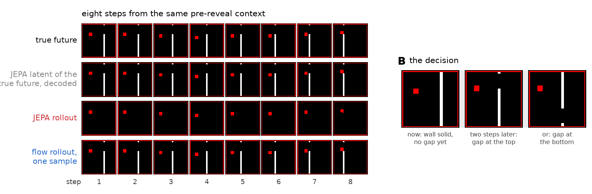
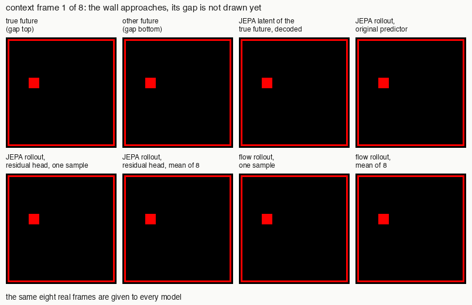
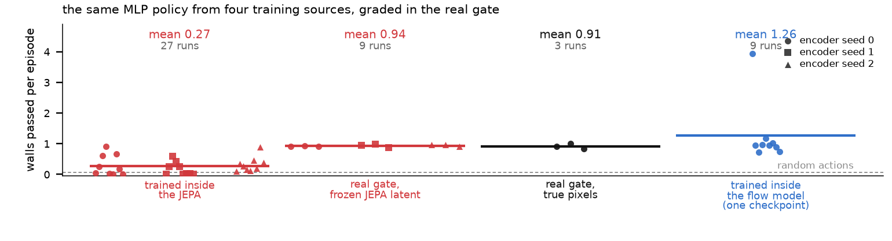
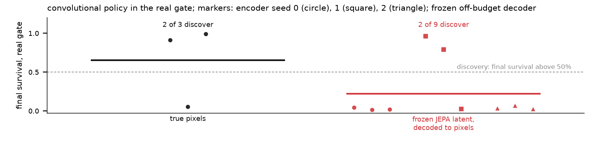
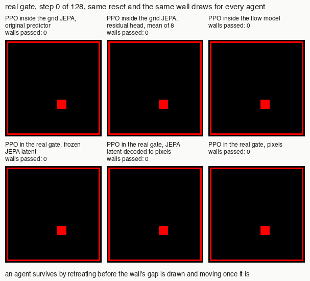
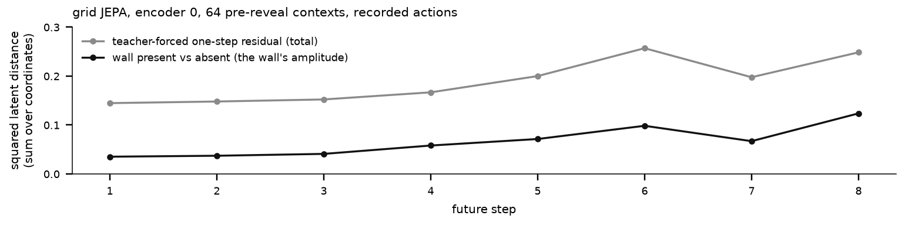

# Научиться игнорировать важное: JEPA сохраняет куб и теряет стену

*Инженерная заметка, 19 сентября 2026. Спутник статьи, поданной на ICLR 2027.*

Невырожденное представление, из которого можно восстановить стену, ещё не гарантирует успешного управления через воображаемое будущее. В проверенной JEPA обучение на настоящих переходах с замороженным представлением даёт лучший результат, чем весь конвейер воображения: предиктор, обученные модули награды и завершения эпизода и протокол PPO вместе.

## Ворота: сначала отступить, потом выбирать

Красный куб движется по кадру, а справа приближается стена. Проход в ней откроется сверху или снизу с равными вероятностями, но до определённого момента стена сплошная. Касание стены или границы завершает эпизод со штрафом; на остальных шагах награда отсутствует. Задача агента — пережить эпизод, последовательно проходя стены.

Из центра куб замечает проход слишком поздно: времени до столкновения меньше, чем нужно для перемещения к нему. Поэтому рабочая стратегия требует подготовиться к ещё неизвестному наблюдению. Сначала нужно отойти влево, затем дождаться раскрытия прохода и только после этого выбрать направление. На панели B показано именно это решение. Успех зависит от своевременного отступления, а не от угадывания будущей стороны прохода.

*На панели B показан момент решения, а на панели A сверху вниз идут настоящее будущее, декодированное представление настоящего будущего, развёртка JEPA и одна случайная реализация развёртки flow-модели.*

В этой задаче можно отделить неопределённость от известной опасности. До раскрытия прохода его сторона неизвестна, но сама стена существует и приближается предсказуемо. Хорошая модель должна сохранять это препятствие, даже когда не может назвать будущий проход. Именно поэтому ворота удобны для проверки: потерю стены нельзя оправдать тем, что модель не угадала случайное событие.

## Что JEPA воображает и что сохраняет

Обе модели мира обучены на одинаковых 500 000 переходов со случайными действиями. Каждой отведено десять минут на A100, включая компиляцию. После этого веса модели фиксируются. Обучение политик и дополнительных модулей учитывается отдельно, поэтому равенство бюджета моделей не означает равенства полной стоимости всех экспериментов.

JEPA совместно обучает кодировщик изображения и предиктор следующего скрытого представления по истории представлений и действий. Использован вариант с пространственной сеткой признаков по рецепту LeWM. Целевая функция объединяет квадратичную ошибку предсказания и регуляризатор SIGReg, приближающий распределение представлений к стандартному нормальному. Восстановление изображения и предсказание награды в эту цель не входят. Декодировщик, который превращает представление обратно в картинку, обучается отдельно после фиксации кодировщика.

Генеративная flow-модель обучает кодировщик с восстановлением изображения, а динамику — согласованием потока, которое позволяет получать случайные реализации будущего. Награду и завершение эпизода она предсказывает отдельными обучаемыми модулями, поэтому отличается от JEPA и архитектурой, и обучающими сигналами, и длиной истории.

Панель A сравнивает продолжения одного контекста на восемь шагов. Строка с декодированным настоящим будущим отвечает на вопрос, сохранилась ли стена после кодирования реальных кадров. Строка развёртки JEPA отвечает на другой вопрос: что получится, если продолжать историю собственными предсказаниями. Декодировщик восстанавливает стену из настоящих представлений, но в показанной развёртке JEPA стена исчезает, а куб остаётся. В развёртке flow-модели стена сохраняется и возникает конкретный проход; это пример возможного будущего, а не знание ещё не наблюдавшегося исхода.

*Анимация показывает восемь кадров контекста, затем восемь воображаемых шагов каждой модели.*

Различие между кодированием и предсказанием существенно для интерпретации. По исчезнувшей стене в развёртке нельзя заключить, что кодировщик вообще не видит стены. Но и восстановленная картинка сама по себе не доказывает, что политика сможет использовать сохранённую информацию. Для этого нужна проверка действий в настоящей среде.

## Главный результат: дефицит конвейера воображения

Политики обучаются алгоритмом PPO, который улучшает выбор действий по получаемым наградам. Внутри модели награды и признаки завершения эпизода предсказаны; в настоящей среде они вычисляются по реальным столкновениям. Во всех группах основного сравнения используется одинаковая конструкция полносвязной сети, MLP, хотя размер входа зависит от наблюдения. После обучения все политики проверяются в настоящих воротах.

Основная мера — среднее число пройденных стен за эпизод. Она различает слабые политики даже тогда, когда почти ни одна не доживает до конца. Внутри JEPA среднее составляет 0,27 стены. Это результат по 27 запускам, объединяющим разные инициализации моделей и политик и варианты предиктора. В настоящей среде на замороженных представлениях тех же кодировщиков среднее составляет 0,94 стены по девяти запускам. На настоящих пикселях полносвязная политика достигает 0,91 стены по трём запускам.

*Точки показывают результаты последних сохранённых политик, а средние сопоставляют обучение внутри JEPA, внутри flow-модели и в настоящей среде на замороженном представлении JEPA или пикселях.*

Таким образом, дефицит воображаемого обучения относительно настоящих переходов на тех же кодировщиках составляет 0,67 стены за эпизод. Это сравнение целых способов обучения. Вместе с динамикой меняются источник награды, завершение эпизода, начальные состояния развёрток, длина сбора данных и обновления PPO. Оно не выделяет вклад предиктора и не доказывает, что замена только предсказаний устранит разрыв.

Ошибки дополнительных модулей остаются конкретным альтернативным объяснением: модуль завершения лучше распознаёт гибель у границы, чем у стены, а модуль награды оценивает столкновение со стеной в −0,05 при настоящем штрафе −1. Именно эти сигналы получает политика внутри JEPA. Восстановить препятствие на картинке и правильно оценить последствия действия — разные требования к системе.

Внутри flow-модели среднее по девяти запускам составляет 1,26 стены. Распределение неоднородно: восемь результатов лежат в диапазоне 0,72–1,18, а один достигает 3,95. Поэтому среднее нельзя читать как надёжное освоение стратегии. Этот пример показывает, что на данных и бюджете эксперимента можно обучить модель, сохраняющую стену, и получить полезную политику внутри неё; превосходство семейства моделей из него не следует.

## Стену можно восстановить и использовать

Более прямой тест полезности представления использует свёрточную политику. Она обучается в настоящей среде, но видит только изображения, восстановленные из замороженного представления JEPA. Настоящий кадр поступает кодировщику, затем декодировщику, и только его выход доступен политике. При обучении политики ни кодировщик, ни декодировщик не меняются. Так проверяется, остаётся ли в этом пути достаточно информации для решения задачи.

Стратегия считается найденной, если итоговая доля эпизодов с выживанием превышает 50 %. На декодированных представлениях это происходит в двух запусках из девяти. Оба успеха относятся к кодировщику 1, поэтому результат не означает одинаковой пригодности всех обученных представлений. На настоящих пикселях свёрточная политика находит стратегию в двух запусках из трёх. Здесь, как и в основном сравнении, используются последние сохранённые веса, а не лучший промежуточный результат.

*Показаны итоговые результаты на настоящих пикселях и декодированных представлениях JEPA, причём оба успешных запуска с представлениями относятся к кодировщику 1.*

Это свидетельство существования полезной информации в зафиксированном представлении: агент действительно может научиться действовать через него. Оно не превращает редкие успехи в гарантию и не устанавливает причину неудач воображаемого обучения. Кроме того, декодировщик обучался с восстановлением изображения вне бюджета модели мира, а свёрточная политика отличается от полносвязной в основном сравнении.

*Анимация сопоставляет по одному эпизоду обученных агентов из одинакового начального состояния с одинаковыми стенами и проходами.*

В показанном эпизоде агент, обученный внутри JEPA, погибает, а агенты из flow-модели, с декодированных представлений и с настоящих пикселей доживают до конца. Они отступают, ждут раскрытия прохода и реагируют на него. Эта запись поясняет найденное поведение; частоту успеха нужно оценивать по всем запускам на графике, а не по выбранному эпизоду.

## Почему целевая функция это допускает

Первое теоретическое утверждение касается невырожденности. При оговорённых предположениях о выразительности модели существует глобальный оптимум с нормальным распределением представлений, который совсем не содержит управляемого состояния. Пусть наблюдение включает случайный фон, постоянный внутри эпизода и независимый от состояния. Кодировщик может преобразовать только этот фон в гауссовский вектор, а предиктор — копировать его. Тогда и ошибка предсказания, и популяционный регуляризатор равны нулю. Представления разнообразны, но положение объекта в них отсутствует. Защита от схлопывания в константу сама по себе не задаёт, какую информацию сохранять.

Второе утверждение отделяет декодируемость от масштаба. Можно построить точно гауссовское представление, из которого полезный двоичный признак восстанавливается без ошибки, хотя расстояние между его значениями сколь угодно мало. Для нового случайного признака оптимальное по квадратичной ошибке предсказание теряет его, заплатив сколь угодно малую цену. Точное восстановление информации из истинного представления поэтому не гарантирует, что ошибка её предсказания заметно повлияет на общую функцию потерь.

Это утверждения о допустимых решениях и отсутствии гарантии, а не описание траектории обучения наших моделей. В частности, конструкция с новым случайным признаком не объясняет исчезновение предсказуемой стены. Связь с экспериментом ограничена различием между наличием информации и её масштабом в пространстве представлений.

*На каждом показанном шаге квадрат амплитуды стены в представлении JEPA ниже одношаговой ошибки предиктора на настоящей истории.*

Для этой диагностики сравниваются представления одной траектории со стеной и без неё. Их расстояние характеризует изменение, связанное со стеной; отдельно измеряется ошибка следующего предсказания при подаче настоящей истории. График показывает соотношение масштабов внутри одной модели. Он не доказывает, что малая амплитуда вызывает исчезновение стены или неудачу политики, и не даёт общей шкалы количества информации для разных моделей.

## Что не помогло

Обученный на замороженном представлении остаточный предиктор проверен со случайной реализацией и со средним восьми реализаций: оба режима дают 0,26 стены против 0,27 у исходного предиктора. Эта проверка не устанавливает и не исключает усреднение как причину сбоя; среднее конечной выборки также не равно точному условному среднему. Удвоение и учетверение числа шагов обучения JEPA, до 17 000 и 34 000 соответственно, оставляет итоговое выживание PPO на уровне 0–3 % в проверенном переборе.

## Ограничения

Исследование охватывает одну целевую функцию JEPA, один мир с воротами и десятиминутные бюджеты моделей с ограниченной проверкой более долгого обучения. Для flow-модели использован один набор обученных весов: повторные обучения политик не заменяют независимых обучений модели. Полносвязная политика не находит стратегию и на настоящих пикселях, поэтому её неудачи нельзя приписать только представлению или считать установленным пределом выразительности сети. Рецепты PPO в настоящей и воображаемой среде различаются, и измеренный разрыв относится ко всему конвейеру. Результаты показывают полезность сохранённой информации и недостаточность проверяемых гарантий, но не устанавливают единственную причину сбоя и не предлагают проверенного способа его устранить.

Численные результаты взяты из журнала запусков; для политик использованы итоговые оценки.
